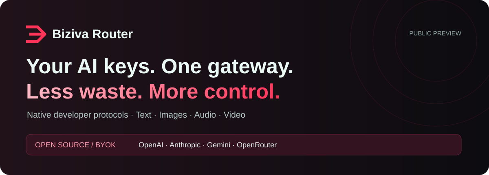

# Biziva Router — One local dashboard for your AI keys



[](https://github.com/omatheuslop/biziva-router/actions/workflows/test.yml)
[](https://nodejs.org/)
[](LICENSE)

**Chat with your own AI providers, choose approved models by task, and track calls and costs — from a local desktop dashboard.** Free, open-source software. Bring your own Biziva, OpenAI, Anthropic, Gemini or OpenRouter API key; provider usage is billed separately.

### Download and try

[**Windows x64**](https://github.com/omatheuslop/biziva-router/releases/download/v0.4.0/BizivaRouter-windows-x64-setup.exe) · [**Mac Apple Silicon**](https://github.com/omatheuslop/biziva-router/releases/download/v0.4.0/BizivaRouter-macos-arm64.dmg) · [**Linux x64**](https://github.com/omatheuslop/biziva-router/releases/download/v0.4.0/BizivaRouter-linux-x64.tar.gz)

[Release notes & checksums](https://github.com/omatheuslop/biziva-router/releases/tag/v0.4.0) · [First-use guide](docs/start-here.md) · [Português 🇧🇷](docs/README.pt-BR.md) · [Codex & Claude setup](docs/developers.md)

**See the journey before adding a key:** [open the interactive demo file](docs/demo.html), download it with GitHub’s **Download raw file** button and open it in your browser. It uses fictional data, works offline and makes no API calls. It is a walkthrough, not the live product.

1. **Open:** install the package for your system and create your local account.
2. **Connect:** add your own API key and approve a model/price for your task.
3. **Try:** write a request, preview without calling the provider, then explicitly confirm a paid generation.

Desktop packages are a **public preview**. Windows is not publisher-signed; macOS is not Apple-notarized. No Mac Intel package is available. [Installation help and limitations](docs/start-here.md).

### Is this for you?

- **Writers and small teams:** one place for chat, summaries, writing and planning with your existing API accounts.
- **Developers:** native OpenAI/Anthropic/Gemini protocols, gateway tokens, idempotency and opt-in cache. [Integration recipes](docs/developers.md).
- **Cost-conscious builders:** compare approved routes and avoid eligible duplicate calls. [Three practical recipes](docs/recipes.md).

Created and maintained by [Matheus Lopes](https://github.com/omatheuslop) at [Biziva](https://biziva.com.br). Free, Apache-2.0 software. Self-hosted, with **zero runtime npm dependencies**.

**Release status: 0.4.0 — public preview.** Protocols and failure handling are exercised with synthetic providers. This is not a claim of provider certification, universal savings, identical model quality, or production validation of every model.

## What you gain

| Need | What the router gives you |
| --- | --- |
| Connect multiple AI providers | One local gateway with native OpenAI, Claude and Gemini protocols. |
| Keep provider secrets out of apps | An encrypted server-side key vault and separate gateway tokens per account. |
| Stop paying for accidental repeats | Durable idempotency, explicit exact cache and no blind paid retries. |
| Choose a cheaper model deliberately | Task-specific routing across your approved, compatible catalog, with consent. |
| Send less irrelevant material | Opt-in exact instruction deduplication and selection of optional documents. |
| Understand what happened | Request, cache and uncertainty metrics; reported costs are separated from unknown costs. |

**Where savings come from:** ten eligible identical requests with exact cache enabled can make one upstream call while that cached result is valid. This is an illustration, not a measured benchmark. Ten different generations still require ten generations. Changing only the base URL in a Codex/Claude session does not automatically compress its history or make its model cheaper.

There is no Biziva software subscription for running this Apache-2.0 project. You pay your providers and any hosting you choose. You manage deployment, backups and model qualification. A ChatGPT/Claude subscription does not automatically provide API credits.

## What ships

- OpenAI native Chat Completions and **Responses**, including streaming, function calls, reasoning fields and assistant `phase` preservation for **Codex** integrations.
- Anthropic native **Messages**, token counting, thinking, tools, beta headers and SSE for **Claude Code** integrations.
- Images (generation/edits/variations), speech, transcription/translation, embeddings, asynchronous video submission/status/content, file upload/retrieval and native OpenAI realtime WebSocket tunneling.
- Gemini native generate/stream/embedding and long-running prediction endpoints; operation retrieval is scoped to the creating gateway account. Availability depends on the provider model/API.
- OpenRouter native OpenAI-format endpoints; a gateway route does not make an unsupported upstream feature available.
- Guided first access, encrypted BYOK credentials, account-scoped route/price editor, three explicit economy profiles, a free preview/confirmed paid playground and request/cache/uncertainty metrics.
- Explicit qualified routing, exact response cache, conservative context controls and durable idempotency.
- **No runtime npm dependencies.** Node.js 24 or later, built-in SQLite and AES-256-GCM.

## Desktop dashboard

The desktop build bundles Node and opens a local Biziva dashboard with chat, encrypted provider keys, task-specific assistants, approved routes, cost previews and consumption. Create a local name/password, add your own key, approve a route and review each paid request. No terminal or Node installation is needed to run a packaged build.

Download only the assets actually attached to [Releases](https://github.com/omatheuslop/biziva-router/releases). Desktop packages are public previews: macOS builds use an ad-hoc signature, not Apple notarization; Windows builds are not publisher-signed. CI builds Windows, macOS and Linux packages; availability is shown by the release assets. The app runs locally while open and requires an Internet connection to your provider.

Six task assistants cover general help, writing, summaries, code, planning and analysis. They produce responses using your keys; they do not execute code, browse or take autonomous external actions. Text, images, voice and video forms depend on qualified provider routes. OpenRouter public model metadata can fill a route, but approval remains yours.

## Run locally

```sh
git clone https://github.com/omatheuslop/biziva-router.git
cd biziva-router
npm ci
npm run setup
npm start
```

Requires Node.js 24+. Setup creates a private `.env` **once** and preserves it on subsequent runs. `npm start` loads it automatically; existing environment variables take precedence. Keep this file and the database across restarts. Never regenerate the master key for an existing database.

On a new local installation, `npm start` shows a **private first-access link** in your interactive terminal. Open it, choose your account name and create a password. The wizard connects you automatically. Add your provider key, configure approved routes/prices in the dashboard, choose an economy profile, then simulate a request for free before explicitly confirming a paid test. **No configuration-file editing is needed for this journey.**

The private link expires after ten minutes and can create only the first account; it is not shown in redirected/service output or remote/container installations. Return with your account name and password. Existing administered accounts can still use their personal codes. Keep your master key and database backed up securely. [Dashboard walkthrough and boundaries](docs/workspace.md).

The server binds to loopback by default. For remote access, use HTTPS at a reverse proxy, set `ROUTER_PUBLIC_ORIGIN=https://your-host`, and configure `ROUTER_HOST` explicitly. See [operations](docs/operations.md). No hosted signup, billing or provider credits are bundled.

## Use your existing SDK

Point the SDK at `http://127.0.0.1:8787/v1`, replace its API key with your **gateway token**, and request the exact model available to your own provider account. OpenAI is the default; send `X-Biziva-Provider: openrouter` to use OpenRouter. `/v1/messages` selects Anthropic; `/v1beta/...` selects Gemini. Provider credentials stay on the server.

[Codex and Claude Code configuration](docs/developers.md) · [HTTP and media examples](docs/api.md) · [optimization contract](docs/optimization.md)

## Four controls, no hidden shortcuts

1. **Cheaper qualified model:** `model: "biziva-auto"`, `X-Biziva-Allow-Model-Switch: 1`, a task label and an output budget select from your configured approved catalog. No model is approved merely because it is cheaper. Explicit models are preserved. Stateful/tool developer sessions use explicit models.
2. **Exact response cache:** `X-Biziva-Cache: exact` enables a five-minute account/credential/request-scoped cache for eligible non-streaming plain chat and embeddings. No semantic cache, no media-generation reuse, no tool-action reuse. New generations remain new by default.
3. **Context:** opt-in removal of exact adjacent instruction duplicates; `/router/context/select` ranks documents that you explicitly identify as optional. Required documents are retained or the request is refused. Conversation/tool history is not silently truncated or summarized.
4. **Duplicate prevention:** `Idempotency-Key` claims the operation durably before dispatch. Ambiguous outcomes are never retried automatically, including after process restart. Streaming/binary output is not retained for replay: a repeated key is refused after completion rather than generating again.

The metrics distinguish known provider cost, unknown cost, cache hits and actual calls. UTF-8 byte reductions are **not** reported as measured token reductions. Lower token count and lower dollar cost are different things. No savings percentage is promised.

## Privacy and scope

The operator controls the installation and can access its secrets. Prompts/outputs must reach the selected provider. Exact cache and JSON idempotency replay store encrypted output locally; metadata includes provider/model/path, usage and timing, never full prompts or provider keys. Metadata retains up to 30 days; idempotency/resource tombstones are retained to prevent unsafe reuse. See [security](SECURITY.md).

This project contains a new standalone gateway and conservative policy helpers. **It does not contain Biziva production source, client data, provider keys, internal prompts or billing rules.** The internal Biziva deployment has separate authentication, qualified model registry, accounting and media validation.

## First useful request

Follow [the first request guide](docs/quickstart.md) to create a gateway account, register a provider key and send an explicit-model request. Start with the model you already use; enable savings controls only where they fit the task. The guide explains the expected response, common errors and how to verify a cache hit without confusing historical usage with new spend.

## Verify and contribute

```sh
npm test
npm run check
```

Tests use synthetic credentials, isolated SQLite, mock providers and local-only transports. They never generate billable content. Report a bug with a minimal **redacted** reproduction; never include API keys or private conversations. See [CONTRIBUTING](CONTRIBUTING.md).

Apache-2.0. Provider terms and model access remain your responsibility; a ChatGPT or Claude subscription is not automatically an API credential.

[New in 0.4: local recovery, encrypted backups, conversations, request tracking and simpler media controls](docs/upgrade-0.4.md).
